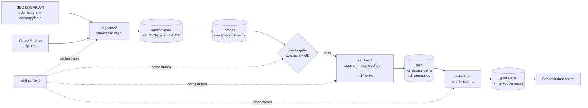

# Financial Restatement & Anomaly Detection Pipeline

A self-directed data engineering project. It ingests public company filings from **SEC EDGAR** (XBRL "company facts"), lands the raw files, loads a **DuckDB** warehouse in bronze/silver/gold layers, transforms and tests it with **dbt**, gates it with **data contracts** and **Great Expectations**, and produces a ranked queue of things a financial analyst should review:

| Detected | What it means |
|---|---|
| **Restatement (amendment)** | A company filed a 10-K/A or 10-Q/A that changed a number it had already reported |
| **Restatement (recast)** | A later regular report shows a different value for an old period |
| **Balance-sheet break** | Assets ≠ Liabilities + Stockholders' Equity inside one filing |
| **Scale error** | A quarter's revenue is <5% or >20× the company's usual quarter (e.g. tagged in thousands) |
| **Valuation outlier** | Price-to-sales far outside the company's own history (robust z-score) |

It runs on your laptop (`make demo` needs no network or accounts). A Google Cloud deployment is **designed** in Terraform and validated in CI, but **not deployed**. See [Limitations](#limitations).

## Results on the bundled sample data

`data/sample/` holds three **fictional** companies in the exact JSON shape EDGAR returns, with one planted case per rule. CI runs the whole pipeline on it on every push. Output ([`reports/demo_alerts.md`](reports/demo_alerts.md)):

| Priority | Company | Type | Metric | Period | Change | Action |
|---:|---|---|---|---|---:|---|
| 100 | CDRH | SCALE_ERROR | Revenue (quarter) | 2022-09-30 | −99.90% | Immediate review |
| 57 | HRBL | BALANCE_SHEET_BREAK | Assets | 2023-12-31 | +2.33% | High priority |
| 55 | NWDV | RESTATEMENT (10-K/A) | NetIncomeLoss | 2023-12-31 | −6.00% | High priority |
| 55 | NWDV | RESTATEMENT (10-K/A) | Revenues | 2023-12-31 | −6.00% | High priority |
| 40 | HRBL | RESTATEMENT (recast) | Revenues | 2022-12-31 | −0.50% | Monitor |
| … | | | | | | |

All planted cases are found and nothing else is: a quarter and a full year that end on the same day are correctly *not* compared (a real bug in v1 of this project; see [docs/LESSONS_FROM_V1.md](docs/LESSONS_FROM_V1.md)).

## Architecture



| Layer | Tables | Built by |
|---|---|---|
| landing | `data/landing/<source>/<cik>/<date>.json.gz` | `ingestion/landing.py` |
| bronze | `raw_companies`, `raw_filings`, `raw_financial_facts`, `raw_market_data`, `ingestion_runs` | `ingestion/loader.py` |
| silver | `stg_*` views; `int_filing_comparisons`, `int_balance_sheet_checks`, `int_quarterly_revenue`, `int_scale_checks`, `int_market_valuation` | dbt |
| gold | `dim_companies`, `dim_filing_periods`, `fct_restatements`, `fct_anomalies`, `alerts` | dbt + `detection/` |

Details: [docs/ARCHITECTURE.md](docs/ARCHITECTURE.md) · column-level meaning: [docs/DATA_DICTIONARY.md](docs/DATA_DICTIONARY.md)

## Quick start

```bash
make setup        # Python 3.11 venv, dependencies, dbt packages
make demo         # sample data → contracts → GE → dbt build → alerts (no network)
WAREHOUSE_DB_PATH=$PWD/demo.duckdb make dashboard   # http://localhost:8501
make test         # 29 unit + integration tests (includes a real dbt build)
```

Live data from SEC EDGAR (free, no API key, but SEC requires you to identify yourself):

```bash
cp .env.example .env            # set EDGAR_USER_AGENT="Your Name you@yourdomain.com"
make pipeline                   # ingest → quality → transform → detect
cat reports/alerts.md
```

`make help` lists every command. Each one is a plain `python -m ...` or `dbt` call you can run on its own.

## Quality: four layers

1. **Data contracts** (`quality/data_contracts/*.yml`, run by `quality/check_contracts.py`): schema, nullability, uniqueness, patterns, row rules, volume and freshness on bronze. Error-level breaches exit non-zero and stop the pipeline *before* dbt.
2. **Great Expectations** (`quality/run_expectations.py`): statistical expectations with `mostly` tolerances.
3. **dbt tests**: 45 schema and singular tests, including that every restatement reconciles to two real facts and a regression test for the quarter-vs-year bug.
4. **pytest**: unit tests for parsing, loading, scoring and contracts, plus an end-to-end test that builds the real dbt project on sample data and asserts exactly what is found.

## How this was built

[docs/BUILD_GUIDE.md](docs/BUILD_GUIDE.md) walks through building this project from an empty folder, phase by phase, with the commands, the reasoning and the checks at each step. It's written so someone else could rebuild it, and so I can explain every decision.

Also in `docs/`: [RUNBOOK.md](docs/RUNBOOK.md) (operating it, and fixing it when it breaks), [LESSONS_FROM_V1.md](docs/LESSONS_FROM_V1.md) (bugs that only real data exposed) and [ROADMAP.md](docs/ROADMAP.md).

## Project layout

```
ingestion/        EDGAR client, landing zone, bronze loader, orchestrator CLI, sample loader
quality/          data contracts + checker, Great Expectations suite + runner
dbt_project/      staging / intermediate / marts models, seeds, macros, tests
detection/        severity thresholds (shared with dbt), priority scoring, alert report
dashboard/        Streamlit app (read-only)
dags/             Airflow DAG (same commands as the Makefile)
terraform/        GCP design: GCS, BigQuery datasets, Cloud Function, Scheduler, IAM
scripts/          sample-data generator
data/sample/      fictional EDGAR-shaped companies used by CI and `make demo`
docs/             build guide, architecture, data dictionary, runbook, lessons, roadmap
```

## Limitations

- **"Restatement" here means "value changed between filings".** Recasts include legitimate reclassifications (e.g. discontinued operations). The pipeline flags them for review; it doesn't judge intent.
- **Market data** comes from Yahoo Finance via `yfinance`, an unofficial API. Historical market cap is derived as close price × SEC-reported shares outstanding.
- **Not deployed to the cloud.** The Terraform is validated in CI but has never been applied; the Cloud Function handler and a BigQuery dbt target aren't written yet ([ROADMAP](docs/ROADMAP.md)).
- **Sample companies are fictional.** Live runs use real public filings.

## Stack

Python 3.11 · DuckDB · dbt-core + dbt-duckdb · Great Expectations · Airflow · Streamlit + Plotly · Terraform (GCP) · Docker · GitHub Actions
